XSS & CSRF Testing using DVWA

> **Academic hands-on lab** | MCA (Cyber Security), D. Y. Patil Deemed to be University
> **Author:** Priyanka M. Khalkho

Hands-on testing of **Cross-Site Scripting (XSS)** and **Cross-Site Request Forgery (CSRF)** vulnerabilities in a local, intentionally vulnerable web application (**DVWA**), followed by documented security recommendations.

---

## Aim

To study XSS and CSRF vulnerabilities using DVWA and document security recommendations that prevent them.

## Objectives

- Understand how XSS and CSRF attacks work
- Set up and configure DVWA for web security testing
- Observe how insecure input handling leads to XSS
- Observe how CSRF abuses an authenticated session
- Compare behaviour across DVWA security levels (Low, Medium, High, Impossible)
- Recommend secure coding and defensive techniques

## Lab Environment

| Component | Details |
|---|---|
| Host OS | Windows |
| Web server / DB | XAMPP (Apache + MySQL/MariaDB) |
| Target application | DVWA (Damn Vulnerable Web Application) |
| Browser | Google Chrome |
| Scope | Local machine only, no external systems tested |

---

## 1. DVWA Setup (Windows)

1. Started **Apache** and **MySQL** from the XAMPP Control Panel.
2. Placed DVWA in the web root and checked the `config` folder.
3. Updated the database settings in `config.inc.php`.
4. Created/reset the database from the DVWA setup page and logged in.

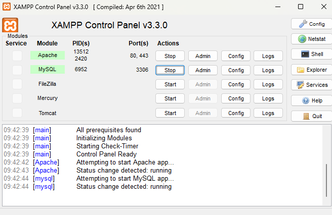
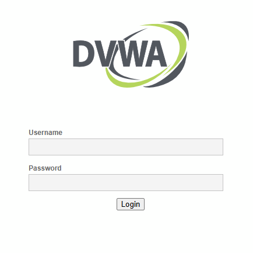

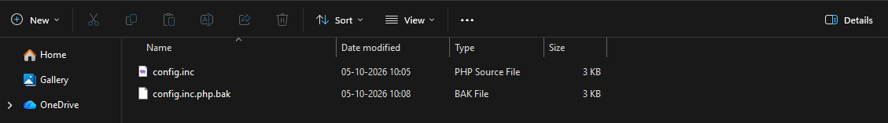
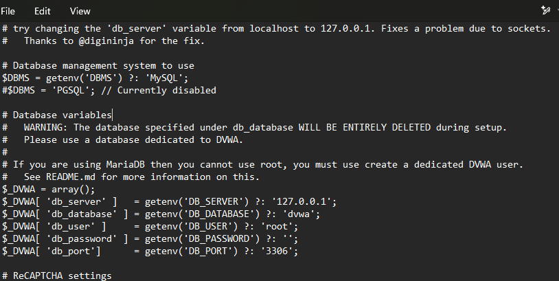

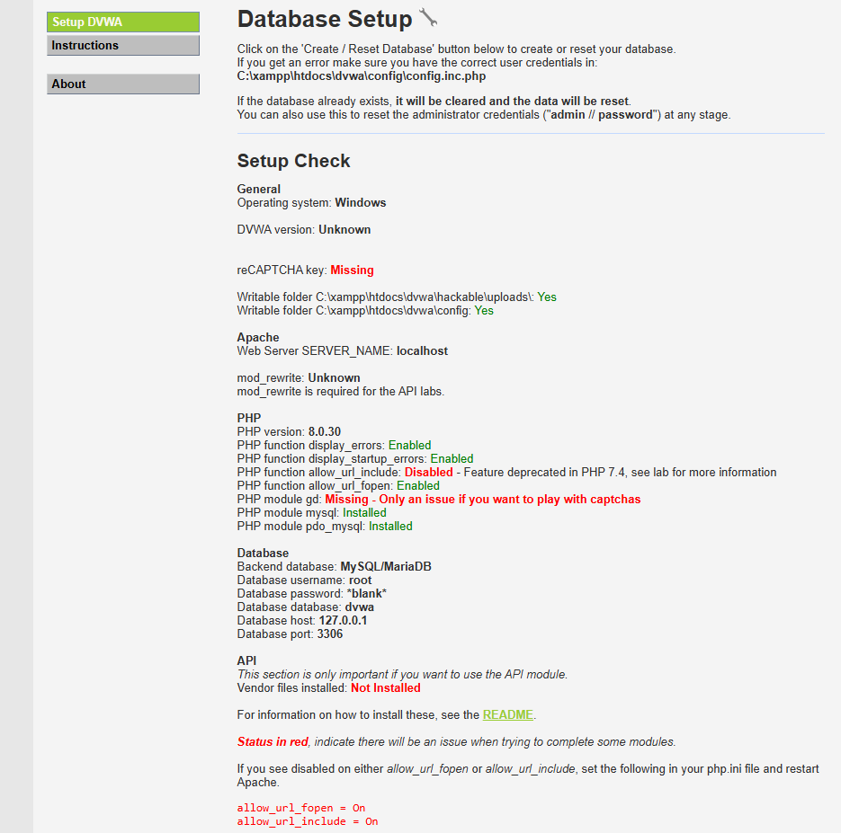

---

## 2. XSS Testing

### Part A: Reflected XSS

A harmless test payload (``) was submitted in the *"What's your name?"* field at each security level, and the response was recorded.

**Low** : the script executed and a JavaScript alert appeared, confirming the input is reflected without validation or encoding.

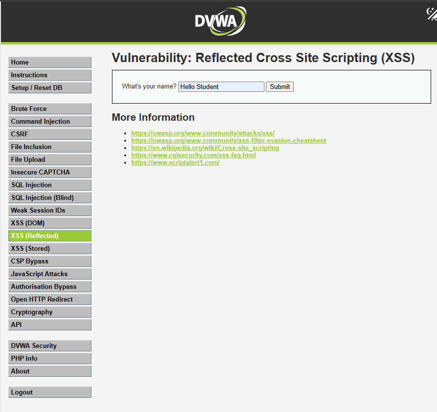
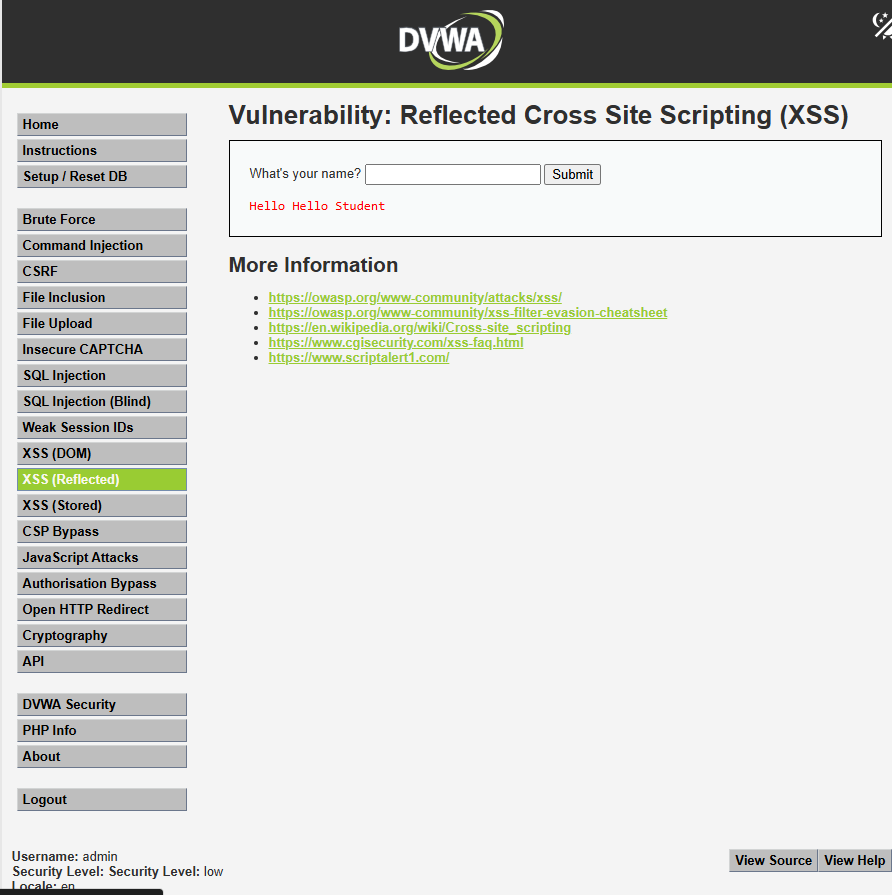
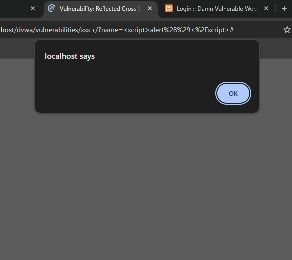

**Medium** : script tags were stripped from the output and only the leftover text was displayed (basic filtering).

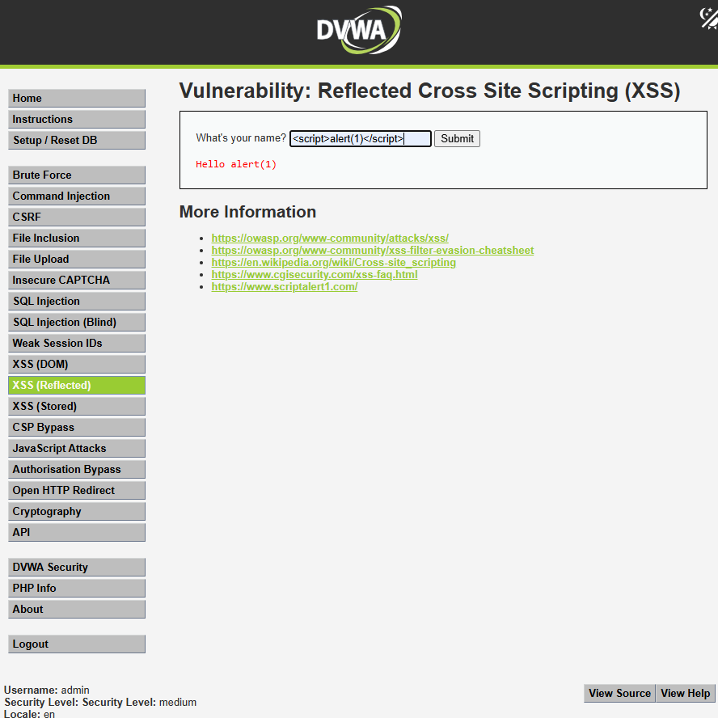

**High** : stricter filtering; the payload did not execute.

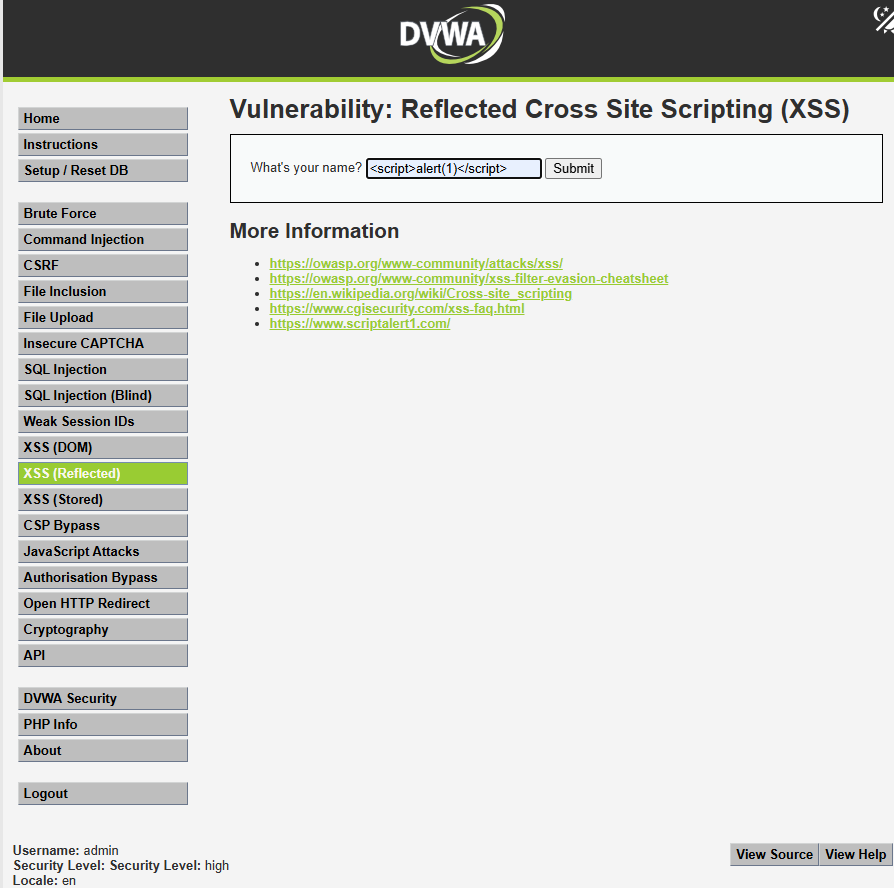
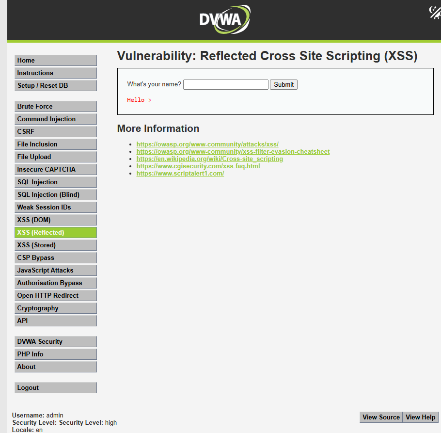

**Impossible** : the payload was displayed as plain text because the output is properly encoded.

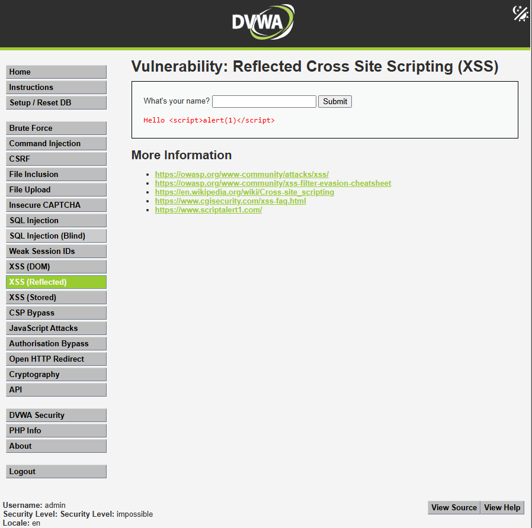

### Part B: Stored XSS

A test message containing a script tag was submitted through the guestbook so it is saved on the server and returned to every visitor.

**Low**

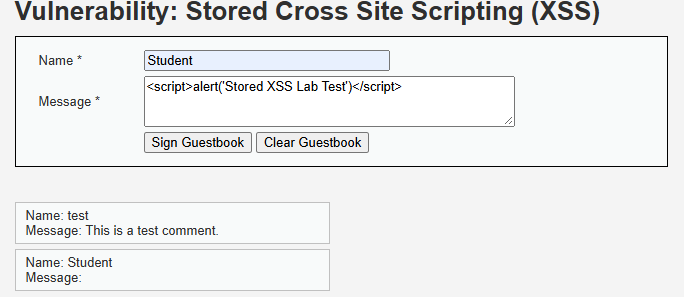
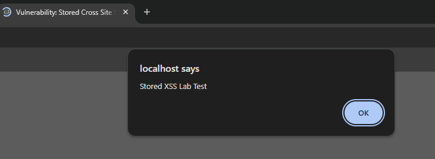

**Medium**

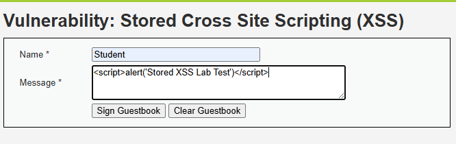
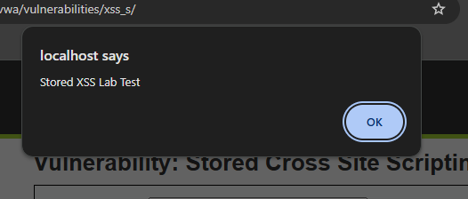

**High**

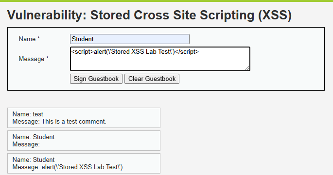
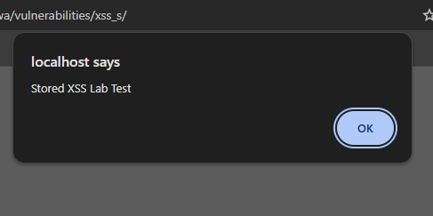

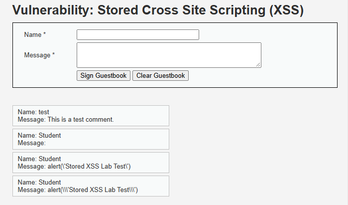

### XSS Findings

| Module | Level | Input | Output | Vulnerable? |
|---|---|---|---|---|
| Reflected XSS | Low | `` | Alert executed | Yes |
| Reflected XSS | Medium | `` | Tags stripped, text shown | Partially filtered |
| Reflected XSS | High | Script payload | Not executed | No (in this test) |
| Reflected XSS | Impossible | Script payload | Shown as plain text | No |
| Stored XSS | Low | Script in guestbook message | Executed on page load | Yes |
| Stored XSS | Medium / High | Script in guestbook message | Filtering applied (see screenshots) | Reduced |

---

## 3. CSRF Testing

**Action tested:** changing the admin password on my own local DVWA account (Low security level).

1. Opened the **CSRF** module and submitted a new password.
2. DVWA accepted the change (**"Password Changed."**) with no anti-CSRF token or confirmation of the current password. The request was a **GET** with the new password in the URL query string.
3. Verified with the *Test Credentials* page: the old password was rejected and the new password was valid.

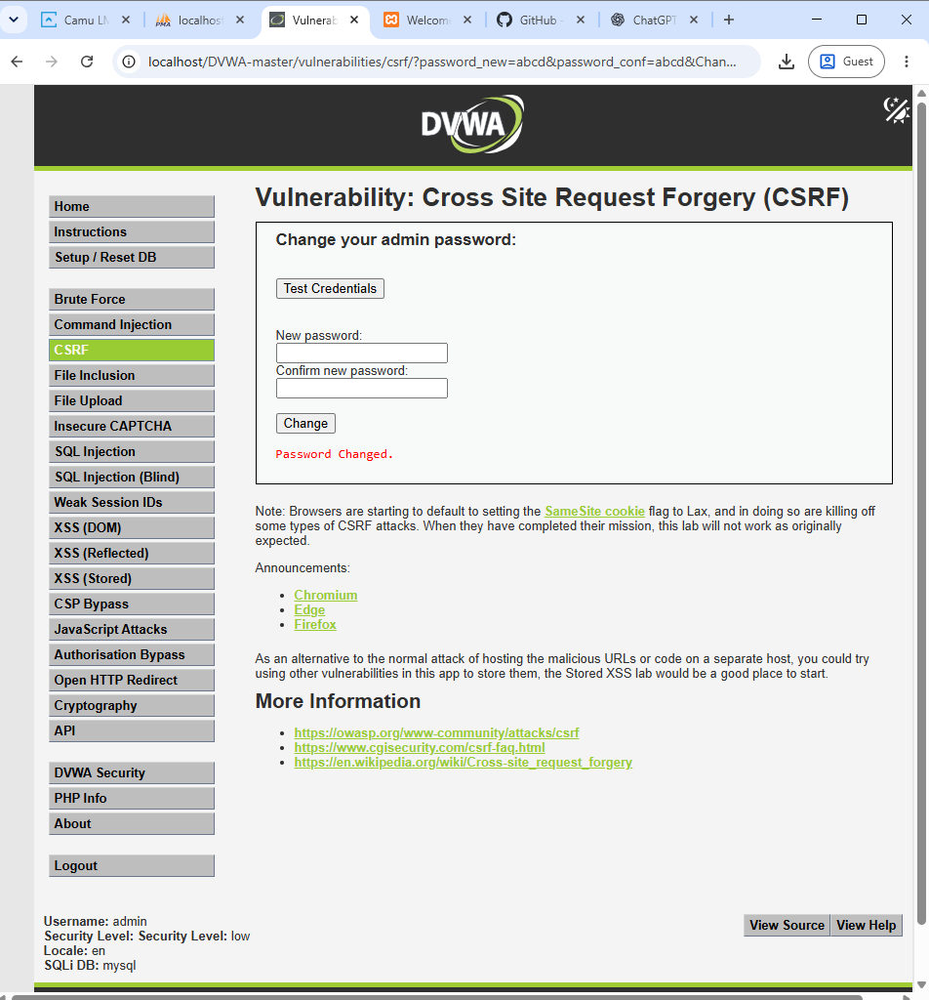

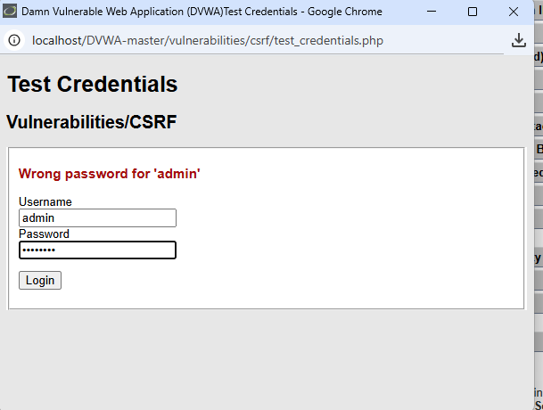
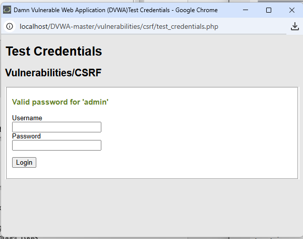

### CSRF Findings

| Parameter | Observation |
|---|---|
| Module | CSRF |
| Action tested | Password change on own account |
| Request method | GET (parameters visible in the URL) |
| Token validation | Not enforced at Low level |
| Result | Request accepted, password changed |
| Recommendation | CSRF tokens, SameSite cookies, current-password confirmation, POST for state-changing actions |

---

## XSS vs CSRF

| XSS | CSRF |
|---|---|
| Runs unintended scripts in the user's browser | Makes an authenticated browser send unintended requests |
| Exploits missing input validation / output encoding | Exploits missing request validation |
| Needs a page that processes user input | Relies on an authenticated user session |
| Client-side script execution | Unauthorized actions as the logged-in user |

---

## Security Recommendations

### Preventing XSS

| Recommendation | Description |
|---|---|
| Input validation | Validate all user input before processing |
| Output encoding | Encode data before rendering it in HTML/JS contexts |
| Content Security Policy (CSP) | Restrict execution of untrusted scripts |
| Secure coding | Avoid inserting untrusted input directly into HTML or JavaScript |
| Regular testing | Perform periodic application security assessments |

### Preventing CSRF

| Recommendation | Description |
|---|---|
| CSRF tokens | Unique, unpredictable token in every sensitive request |
| SameSite cookies | Reduce cross-site request risk |
| Origin/Referer validation | Verify the source of sensitive requests |
| User confirmation | Require re-authentication or confirmation for critical actions |
| Session security | Use secure session management practices |

---

## Key Learnings

- Reflected and stored XSS differ in persistence: stored payloads affect every visitor.
- Blacklist-style filtering (Medium/High) is weaker than proper context-aware output encoding (Impossible).
- State-changing actions should never rely on GET requests or on the session cookie alone.
- Findings are only useful when documented with evidence and a clear fix.

## Limitations & Ethical Use

- DVWA is intentionally vulnerable; real production apps behave differently.
- Results depend on the selected security level.
- All testing was done on my own local machine in an authorized lab. **Do not expose DVWA to the internet** and do not test systems you do not have permission to test.

## Skills Demonstrated

`Web Application Security` · `XSS` · `CSRF` · `DVWA` · `XAMPP` · `Vulnerability Assessment` · `Security Documentation` · `Remediation Recommendations`

## Conclusion

The lab showed how improper input handling enables XSS and how weak request validation enables CSRF. Input validation, output encoding, CSRF tokens, secure cookie settings and CSP significantly reduce these risks.
